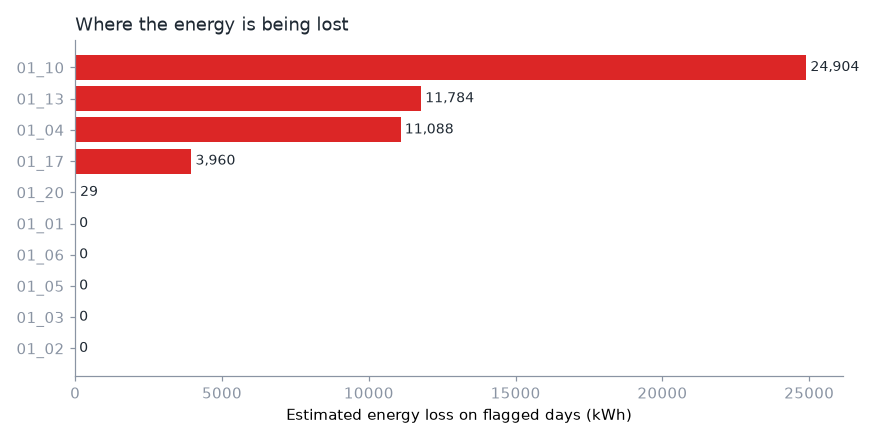
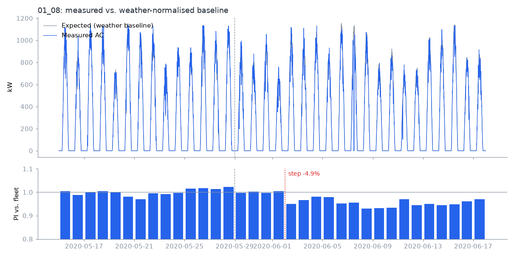
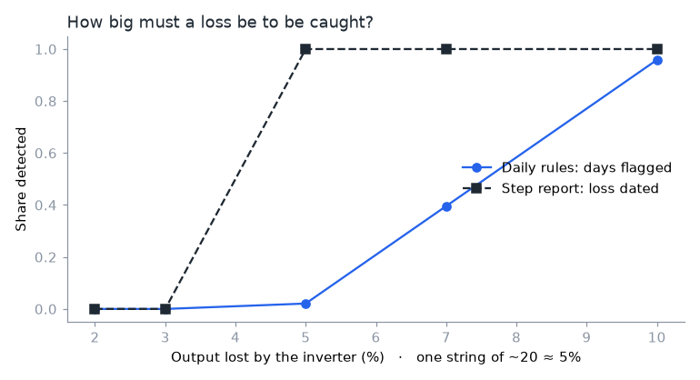
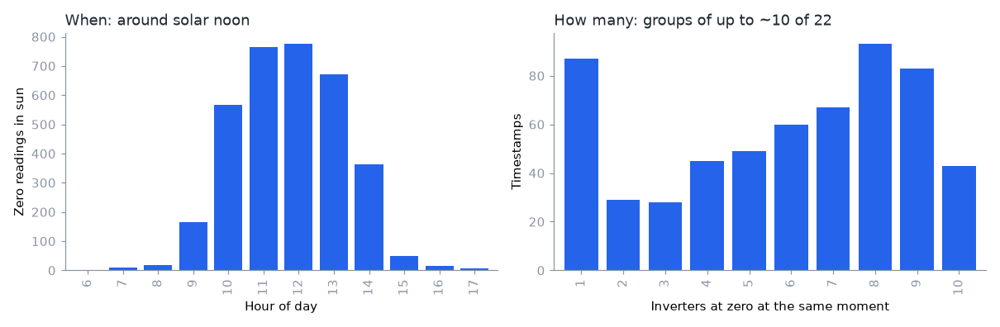

# PV Anomaly Detection with Weather-Normalised Baselines

Which inverters lost energy, why, and how much? This project compares each
inverter's output with **what the weather should have produced**, learned from
the plant's own history. It then turns the gap into alarms with a reason and an
energy loss in kWh.

**→ Read the full analysis: [analysis.ipynb](analysis.ipynb)**

Python · pandas · scikit-learn · matplotlib · pytest



## Plant topology and fault attribution

In the field I name every asset by where it hangs in the plant:

```
TT_II_SS     TT = transformer (01-99) · II = inverter (01-99) · SS = string (01-99)
01_07_14     string 14 of inverter 07 on transformer 01
```

A fault is attributed to the **lowest level that explains it**. When **≥ 80% of
the children drop at the same moment**, the cause is the parent (inverter →
transformer → grid). One grid trip is then reported once, not as 22 inverter
alarms. This project works at inverter level (`TT_II`).

## Method

1. **Weather baseline.** For each inverter, a robust regression fitted on 14 days
   of history: `P ≈ f(G, G·(T_mod − 25), G²)`, the PV power equation expanded.
2. **Plant events.** If ≥ 80% of the inverters drop together, the event goes to
   the plant.
3. **Rules,** one function each in [pvad.py](pvad.py):

   | Rule | Fires when |
   |---|---|
   | Zero output in daylight | ≥ 1 h at zero with the sun up |
   | No data | ≥ 1 h without a reading |
   | New fault | below 93% of its **own best days** *and* of the fleet |
   | Chronic | typically below 90% of its **best peers** |

4. **Step report.** Dates the day a lasting drop started, such as one string
   opening.

## Results

**Synthetic plant with injected faults** (public data has no labels):

- Outage, intermittent trips, logger gaps and a chronic inverter: all caught,
  with **0 false alarms**.
- A grid trip: reported once, at plant level.
- **One open string (5% loss)**: under the daily alarm, but the step report dates
  it to the exact day (−4.9%).



**Detection limit.** Daily alarms are reliable from ~10% loss. The step report
catches a single string (~5%). Below ~4%, the single weather sensor is the noise
floor.



**Real plants (Kaggle, India, 22 inverters, 34 days).**
- **Plant 1:** a DC column scaled ~10×, caught by the data-quality check.
- **Plant 2:** two chronic inverters (PI ~0.7) and 10 h of plant-wide events.
  There are also 131 midday outages in **rotating groups of up to 10
  inverters**, which points to curtailment or a recording issue, not 131 trips.
  With the real transformer map, the 80% rule would turn them into one
  transformer event per day.



## Run it

```bash
pip install -r requirements.txt
pytest                      # 17 tests
jupyter notebook analysis.ipynb
```

The real-plant section needs the 4 CSVs from
[Kaggle: Solar Power Generation Data](https://www.kaggle.com/datasets/anikannal/solar-power-generation-data)
in `data/`. The synthetic part runs without them.

## Limitations

- 34 days of data: no seasonality.
- One irradiance sensor per plant.
- No real topology in public data.
- Synthetic results show the method works on the injected fault shapes. They are
  not a claim about any specific plant.

---

Douglas Geraldi, electrical engineer (UNICAMP B.Sc./M.Sc.) working on energy and
data. The approach comes from PV performance work I did professionally. This
repository rebuilds it on public and synthetic data, with no client data.
